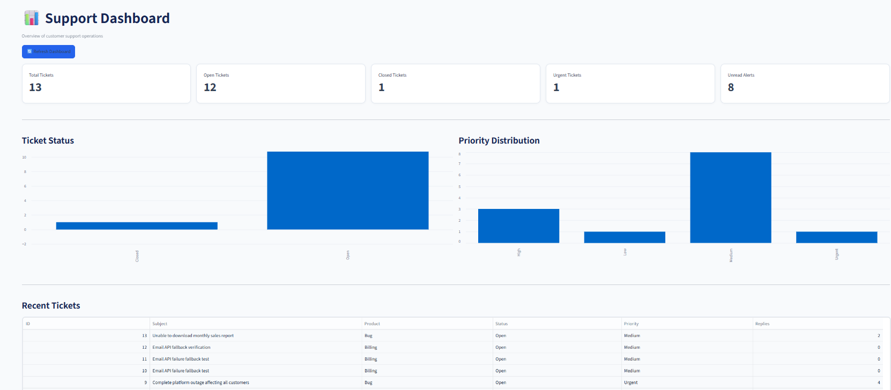
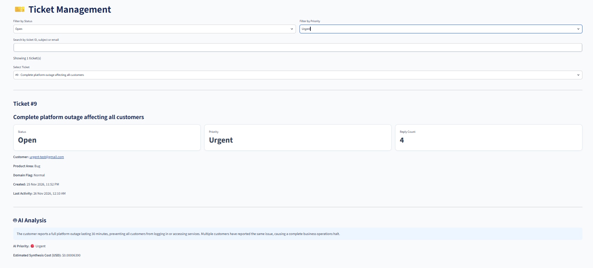
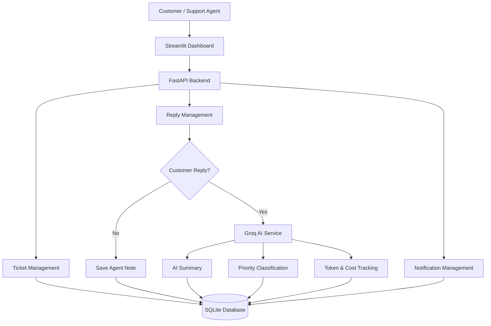

# 🎫 Ticket Triage Assistant

<p align="center">
  <strong>AI-Powered Customer Support & Intelligent Ticket Management</strong>
</p>

<p align="center">
  Automating ticket summarisation, priority classification and support workflows using Large Language Models.
</p>

<p align="center">
  
  
  
  
  
  
</p>

---

## ✨ Overview

**Ticket Triage Assistant** is an AI-powered customer support management application designed to simplify ticket handling and improve support-team efficiency.

Traditional ticket management requires support agents to manually read customer messages, understand the issue, determine its urgency and decide what action to take.

This project introduces an AI-assisted workflow that automatically analyses customer replies, generates concise summaries, classifies ticket priorities and notifies the assigned support team.


## 📸 Application Screenshots

### Support Dashboard

The dashboard provides an overview of ticket operations, including total tickets, open and closed tickets, urgent tickets, unread alerts and priority distribution.



### Ticket Management

View ticket details, filter tickets by status and priority, inspect AI-generated summaries, monitor reply counts and manage customer conversations.




### 🎯 What does it do?

- 🤖 **AI Summarisation** — Converts customer conversations into concise summaries.
- 🚦 **Smart Prioritisation** — Classifies tickets as Low, Medium, High or Urgent.
- 📩 **Email Validation** — Detects disposable email domains using an external validation API.
- 🔄 **Automatic Reopening** — Reopens closed tickets when customers respond.
- 🔔 **Smart Notifications** — Notifies the support team about customer replies.
- 💰 **AI Cost Tracking** — Records token usage and estimates synthesis costs.
- 📊 **Interactive Dashboard** — Provides a central interface for managing tickets and monitoring activity.

---

## 🖥️ Application Architecture



---

## ⚙️ Technology Stack

| Layer | Technologies |
|---|---|
| Frontend | Streamlit |
| Backend | Python, FastAPI |
| Database | SQLite |
| ORM | SQLAlchemy |
| Validation | Pydantic |
| AI Integration | Groq API |
| AI Model | `openai/gpt-oss-20b` |
| Email Validation | Disify API |
| Testing | Pytest, HTTPX |
| API Server | Uvicorn |

---

## 🚀 Key Features

### 1. AI-Powered Ticket Intelligence

Customer messages are analysed using the Groq LLM API.

The system generates:
- A concise ticket summary.
- An appropriate priority level.
- Approximate token consumption.
- Estimated AI processing cost.

### 2. Intelligent Priority Classification

| Priority | Meaning | Example |
|---|---|---|
| 🟢 Low | General enquiries | Invoice or account information |
| 🟡 Medium | Minor functional issues | Isolated bug with a workaround |
| 🟠 High | Significant disruption | Payment deducted but order pending |
| 🔴 Urgent | Critical incidents | Complete service outage or active security breach |

Priority classification considers the reported impact, scope and available workarounds.

### 3. Customer and Agent Reply Management

The application distinguishes between customer replies and internal agent notes.

| Behaviour | Customer | Agent |
|---|:---:|:---:|
| Save reply | ✅ | ✅ |
| Update reply count | ✅ | ✅ |
| Update last activity | ✅ | ✅ |
| Trigger AI analysis | ✅ | ❌ |
| Generate notification | ✅ | ❌ |
| Reopen closed ticket | ✅ | ❌ |

### 4. Resilient Email Validation

The system uses the Disify API to identify disposable email domains.

External API failure does not prevent ticket creation. When validation is unavailable or the response is unexpected, the domain status is recorded as `Unknown`.

### 5. Notification Management

Customer replies generate database-backed notifications containing:

- Ticket subject.
- Customer reply snippet.
- Updated priority.
- Assigned support team.
- Notification read/unread status.

### 6. AI Cost Monitoring

The application records input and output token usage and calculates an approximate synthesis cost.

The cost calculation uses configurable per-million-token pricing assumptions. These values are estimates, not verified live billing rates.

---

## 📂 Project Structure

```text
ticket-triage-assist/
│
├── app/
│   ├── prompts/
│   ├── routes/
│   ├── services/
│   │   └── ai_service.py
│   ├── __init__.py
│   ├── database.py
│   ├── main.py
│   ├── models.py
│   └── schemas.py
│
├── frontend/
│   └── dashboard.py
│
├── tests/
│   ├── conftest.py
│   └── test_tickets.py
│
├── .streamlit/
│   └── config.toml
│
├── .env.example
├── .gitignore
├── requirements.txt
├── requirements-dev.txt
└── README.md
```

> Note: The `prompts` and `routes` directories are reserved for future modularisation. The currently implemented API endpoints are defined in `app/main.py`.

---

## 🛠️ Installation & Setup

### Prerequisites

- Python 3.12 or later
- Groq API key
- Visual Studio Code (recommended)

### 1. Clone the repository

```bash
git clone <YOUR_REPOSITORY_URL>
cd ticket-triage-assist
```

### 2. Create a virtual environment

```powershell
python -m venv venv
```

Activate it:

```powershell
.\venv\Scripts\Activate.ps1
```

### 3. Install dependencies

```powershell
python -m pip install -r requirements.txt
```

For development and testing:

```powershell
python -m pip install -r requirements-dev.txt
```

### 4. Configure environment variables

Create a `.env` file in the project root:

```env
GROQ_API_KEY=your_groq_api_key
GROQ_MODEL=openai/gpt-oss-20b

EMAIL_VALIDATION_API_URL=https://www.disify.com/api/email

GROQ_INPUT_PRICE_PER_MILLION=0.075
GROQ_OUTPUT_PRICE_PER_MILLION=0.30
```

Replace the placeholder with your actual Groq API key.

**Security:** Never upload `.env` or expose your API key in GitHub.

### 5. Start the backend

Open Terminal 1:

```powershell
python -m uvicorn app.main:app --reload --port 8001
```

Backend:

`http://127.0.0.1:8001`

API documentation:

`http://127.0.0.1:8001/docs`

Health check:

`http://127.0.0.1:8001/health`

### 6. Start the frontend

Open Terminal 2:

```powershell
python -m streamlit run frontend/dashboard.py
```

Dashboard:

`http://localhost:8501`

**Important:** Both backend and frontend terminals must remain running.

---

## 🧪 Testing

The project includes an automated test suite using Pytest.

Run:

```powershell
python -m pytest -v
```

### Test Coverage

| Test Case | Status |
|---|---|
| Invalid email rejection | ✅ Passed |
| Email API failure fallback | ✅ Passed |
| Customer reply reopens closed ticket | ✅ Passed |
| Agent reply does not reopen ticket | ✅ Passed |
| Agent reply does not trigger AI or notifications | ✅ Passed |
| Customer reply triggers AI and notifications | ✅ Passed |
| Unexpected email API response handling | ✅ Passed |

<p align="center">
  
</p>

Tests use an isolated in-memory SQLite database and mocked external API calls.

---

## 🧠 Important Design Decisions

1. **FastAPI for backend services:** Provides a lightweight REST API with automatic interactive documentation.
2. **SQLite for feasibility testing:** Keeps database setup simple without requiring an external database server.
3. **Groq for AI processing:** Provides the LLM integration for conversation summarisation and priority classification.
4. **Customer-only AI analysis:** Avoids unnecessary LLM calls for internal agent notes.
5. **Graceful external API failure:** Keeps ticket creation independent of the availability of the email validation service.

---

## 📈 Scalability Considerations

The current implementation is designed as a feasibility prototype.

For a workload of 10,000 tickets per day, the following changes would be required before production deployment:

- Replace synchronous AI processing with background workers.
- Introduce a message queue for asynchronous ticket analysis.
- Migrate SQLite to PostgreSQL.
- Add retry handling, rate limiting and failure recovery.
- Implement monitoring, logging and performance metrics.
- Introduce authentication and role-based access control.

---

## ⚠️ Current Limitations

- AI-generated priorities require human review.
- AI processing currently runs synchronously.
- SQLite is intended for lightweight prototype usage.
- Authentication and role-based access control are not implemented.
- The system has not been load-tested for 10,000 tickets per day.
- Token costs are approximate estimates.

---

## 🔮 Future Enhancements

- Human-in-the-loop priority correction.
- Automatic agent assignment.
- Background AI processing.
- PostgreSQL integration.
- Role-based access control.
- Advanced analytics and reporting.
- Production monitoring and alerting.
- Integration with CRM and enterprise support platforms.

---

## 🤝 AI Development Disclosure

ChatGPT was used as an AI coding assistant for implementation guidance, debugging, code review, test preparation and documentation support.

AI-generated suggestions were reviewed and tested during development.

---

## 👨‍💻 Project Information

**Project:** Ticket Triage Assistant  
**Category:** AI / Customer Support Automation  
**Purpose:** Feasibility prototype for intelligent ticket management  
**Developer:** [Your Name]

---

<p align="center">
  <strong>Built with Python, FastAPI, Streamlit and Groq AI.</strong>
</p>

<p align="center">
  ⭐ Intelligent Ticket Management · AI Summarisation · Automated Triage
</p>